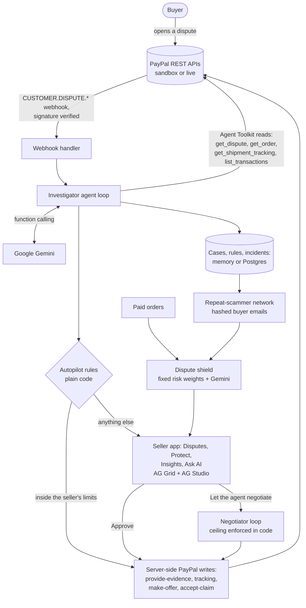

# Countermove

**Stop scammers before you ship. Settle the rest without a fight.**

An AI agent that protects small online sellers before, during and after a PayPal dispute.

**[Live demo](https://rebuttal-6j9a.onrender.com)** (no login) · **[Demo video](https://youtu.be/GnCHcMgndKA)** (under 3 min) · Built for [Build What's Next with PayPal and AI](https://paypalaihackathon.devpost.com/)

_The demo runs on Render's free tier: if nobody has used it for a while, the first load can take up to a minute._

## In 30 seconds

- **Who it's for:** small sellers paid through PayPal with nobody to defend them, like freelancers and craft exporters selling abroad.
- **The problem:** a dispute gives them days to answer. Most refund out of fear or send a reply that leaves out the evidence that would have won.
- **What it does:** when PayPal's dispute webhook arrives, a Gemini agent investigates through the PayPal Agent Toolkit and recommends fight, partial refund or refund, with every fact traced to its source. The seller approves, and the server answers through the PayPal Disputes API.
- **Before and after the dispute:** it checks paid orders for dispute risk before they ship, negotiates partial refunds inside a ceiling the buyer never sees, and warns a shop about buyers other shops have already proven wrong.
- **Try it:** the Simulator returns PayPal's own payloads with no login, and one toggle switches to the real PayPal sandbox.

## Before, during and after a dispute

| When | What Countermove does | Where |
|---|---|---|
| **Before** | Checks every paid PayPal order for dispute risk and offers one action: refund it through PayPal, require a signature, or ship to the PayPal address only. | Protect |
| **Before** | Warns about buyers other shops have already proven wrong (a salted hash of the email, nothing else). | Protect |
| **Before** | Gives the buyer a "fix it first" page: tracking is answered at once from the shop's records, and a refund or replacement request reaches the seller instead of PayPal. | `/fix/{order}` and Protect |
| **During** | Investigates each dispute through the PayPal Agent Toolkit and recommends fight, partial refund or refund. The evidence statement is written and ready behind one control. | Disputes |
| **During** | Negotiates a partial refund inside a ceiling the buyer never sees, and heals its own failed PayPal calls. | Dispute page |
| **After** | **Dispute Reserve:** what to keep in the PayPal balance for the next 30 days, from open disputes and the last 90 days' results. | Insights |
| **After** | **Dispute Doctor:** the repeated causes behind refunds, each with one fix (a signature rule, listing text, an autopilot limit). | Insights |
| **Throughout** | **PayPal API trail:** every PayPal call made by the agent, autopilot, the seller or the server, with status and debug id. | Dispute page and Insights |

**Judge mode** (top bar) plays this whole story in the Simulator in under a minute, on the real pages and API routes.

Dispute Reserve and Dispute Doctor are arithmetic and fixed rules over the shop's own cases (`src/lib/insights.ts`), with no model call, so they give the same answer every time and need no AI quota.

## What makes this different

- **The whole PayPal dispute lifecycle, not a checkout button:** investigate, add tracking, send evidence, offer, refund and the sandbox ruling. It was verified live: evidence accepted, and a $184 "not received" claim ruled for the seller.
- **The model never moves money.** Every PayPal write is made by server code, after the seller approves or inside autopilot rules that are checked in code after the model answers.
- **It acts before a dispute exists.** The dispute shield scores each paid order from fixed, published weights, and Gemini explains what to do before shipping.
- **An AI negotiator with code-enforced limits.** It haggles in the PayPal dispute conversation, and code blocks any move over the ceiling or backwards.
- **One seller's win protects the others.** The repeat-scammer network shares only a salted hash of the buyer's email, never names, addresses or amounts.
- **It heals its own PayPal calls.** Outages are retried and expired tokens refreshed. Business refusals like `INSUFFICIENT_FUNDS` are explained by Gemini, never retried blindly.

## Architecture



Next.js 16 (App Router) and React 19 on one Render web service. The PayPal gateway has two interchangeable backends: the Simulator, which returns PayPal's exact JSON shapes, and the real sandbox. Seller accounts add Postgres (see [Seller accounts](#seller-accounts-for-real-sellers)).

## The story

A buyer says the package never came. The seller has days to respond. Most small sellers either refund out of fear or send a rushed reply that leaves out the evidence that would have won. Countermove investigates each dispute the moment it arrives. It reads the PayPal dispute, the order, the shipment tracker and the buyer's history, plus the shop's own records. Then it recommends one of three moves:

- **Fight**, with an evidence statement written for the PayPal specialist and each fact traced to its source.
- **Partial refund**, with a specific amount, when the seller is partly at fault.
- **Refund**, when the case can't be won and fighting would waste the seller's time.

It runs on **autopilot**: PayPal's dispute webhook starts the investigation, and the seller's own rules decide what happens next. A $28 "never arrived" claim on an untracked letter can be refunded through PayPal before the seller wakes up; a $184 fight waits for the seller, with the evidence written and a **why this decision** breakdown (facts for and against, expected money kept for each option). Guardrails keep autopilot small: a hard dollar limit, no partial-refund offers, and nothing on its own after a failed PayPal lookup.

When a partial refund is the right move, the seller can hand it to the **AI negotiator**. The seller sets a ceiling the buyer never sees, and the agent haggles in the PayPal dispute conversation. It opens low, concedes in shrinking steps, explains each offer, and settles inside the ceiling or hands the case back. In the demo, a $96 chipped-mug claim opens at $24. The buyer counters at $48, the agent offers $32, and the buyer accepts, so the seller keeps $64. Code enforces the ceiling, no-backwards and accept rules after the model answers, so the model can't overspend.

The **repeat-scammer network** means one seller's proven dispute protects every other seller. When a Countermove shop wins a dispute because its evidence contradicted the buyer (a parcel signed for, then claimed "never arrived"), it shares a report: a salted one-way hash of the buyer's PayPal email, the claim type and what the evidence showed. No names, addresses or amounts. Another shop sees the warning on **Protect** before it ships to that account, on the dispute itself while it answers, and as a **Network** badge in the queue; the shield scores it as a sourced signal. In the demo the other shops are simulated and labeled so; the shop's own reports come from its real case history ([`src/lib/network.ts`](src/lib/network.ts)).

The **dispute shield** works before a dispute exists. When an order is paid, the agent checks its dispute risk before the seller ships. It reads the PayPal order (`get_order` from the Agent Toolkit) and the buyer's history, including every dispute Countermove has handled for that buyer (**dispute memory**). Then it tells the seller what to do while they still can. In the demo:

- A $236 bag going overnight to a package forwarder under another name, from an unverified first-time account, is flagged **HIGH**. The advice is to ship only to the PayPal address or refund.
- A repeat buyer's $58 prints are **LOW**.
- A new $148 order from the buyer who is disputing a signed-for tote right now is **HIGH**, with the signature evidence quoted back.

**Self-healing PayPal calls.** When a PayPal write fails, the agent reads PayPal's error (status, name, `debug_id`) and recovers on its own when it safely can:

- A PayPal outage (5xx, timeout) is retried with backoff.
- An expired access token is replaced with a fresh PayPal sign-in and the call repeated.
- Anything PayPal refused for a business reason, like a refund with `INSUFFICIENT_FUNDS` (which our live sandbox seller really returned), is not retried. Gemini diagnoses it in plain words and either pauses the case with steps for the seller or proposes another response.

A proposal always waits for the seller's approval. The agent never changes code and never widens the seller's limits. Every incident lands in an AG Grid log with each attempt and the diagnosis. In the simulator, **Simulator tools → Break PayPal's next call** injects an outage, an expired token or insufficient funds, so you can watch it recover.

The app has four pages, so a seller sees what matters first:

- **Disputes** (home): money at risk, what's due within 3 days, money protected and whether autopilot is on, the latest alerts, and the ranked dispute queue with one **Next step** per row. Click a row for the full case.
- **Protect**: the dispute shield on paid orders and a dispute-memory grid of every buyer who has disputed, flagged when they order again.
- **Insights**: savings, linked charts over an outcomes ledger, the self-healing incident log and the full autopilot history.
- **Ask AI**: the seller asks a question in plain English ("which claim types cost me the most?") and an AI analyst builds the answer as a live dashboard on **AG Studio**, AG Grid's dashboard component, with Gemini driving AG Studio's agent framework.

Autopilot rules live in a drawer (**Autopilot rules**, top right), demo controls in **Simulator tools**, and first-time visitors get a 3-step tour.

The inbox works as a triage queue: disputes are ranked by money at risk and days left before PayPal's response deadline, and a savings dashboard shows money protected, hours saved and how many disputes autopilot closed.

## Try it (no PayPal login needed)

The demo opens on the **Simulator**. The quickest tour is **Judge mode** in the top bar: one click plays the story before, during and after a dispute. To drive it yourself, open **Simulator tools** and click **Simulate a new dispute**: a simulated buyer files a $28 claim, the simulator delivers the same `CUSTOMER.DISPUTE.CREATED` webhook PayPal would, the agent investigates, and autopilot refunds it within your $30 rule. Watch **Latest alerts**. In **Autopilot rules**, set **Send evidence on its own** to 90% and simulate again to see autopilot fight a signed-delivery case. Open a dispute and the agent starts investigating (a saved real Gemini run, replayed). Approve its recommendation, and a few seconds later the simulator plays PayPal's side: the ruling on a fight, or the buyer accepting an offer. Click **PayPal rules for buyer** during the countdown to see a loss instead. Open the $96 mug dispute and click **Let the agent negotiate** to watch the agent haggle with a simulated buyer. On the **Protect** tab, the **Dispute shield** checks three paid orders; click a row to see what the agent found and what to do before shipping. **Simulator tools → Reset demo** starts over. On Disputes, search or filter by claim, stage and amount; the pinned totals row tracks money at risk and kept for whatever is shown. On **Insights**, **Export outcomes (CSV)** downloads the ledger with plain-number amounts. The toggle at the top switches to **Live PayPal sandbox**, which shows real disputes filed by sandbox buyers.

Each browser gets its own simulator, kept by a cookie: several judges can try the demo at once without seeing each other's clicks, and **Reset demo** resets only yours. The live sandbox is one shared PayPal account, so on a production server it is view-only (cases, saved investigations and outcomes); set `LIVE_SANDBOX_WRITABLE=1` to approve and rule on live disputes, as local development does by default.

### Simulator vs live sandbox

| Step | Simulator | Live PayPal sandbox |
|---|---|---|
| AI investigation | Real Gemini runs, replayed from `cache/investigations/` so the free tier's rate limit never stalls a demo. **Re-run** calls the model live. | Live Gemini run against the real dispute through the PayPal Agent Toolkit. |
| Fight: evidence + tracking | Works | Works (verified: evidence accepted, tracking added). |
| PayPal's ruling (sandbox `adjudicate`) | Works | Works (verified: a $184 "not received" claim ruled for the seller, hold released). |
| AI negotiator | Works (simulated buyer with a private minimum) | Code is wired (`make-offer`, `send-message`, webhook resumes the haggle when the buyer answers) but untested live, because the sandbox only gave us chargebacks, where offers aren't allowed. |
| Dispute shield | Works on three paid demo orders | Not wired yet: a live install would collect paid orders from `PAYMENT.CAPTURE.COMPLETED` webhooks. |
| Partial-refund offer | Works | Not possible in our tests: the sandbox opened every buyer dispute as a chargeback, and PayPal allows no offers on chargebacks. The app says so instead of failing silently. |
| Full refund | Works | Works when the seller account has a balance; our India-based sandbox seller had no USD balance, so PayPal returned `INSUFFICIENT_FUNDS`, which the app reports. |

Why both: buyer disputes can only be filed by hand in the sandbox and take minutes to hours to appear, so a judge can't create one on the spot. The simulator returns the same JSON shapes as the sandbox, so the same code paths, UI and agent run in both.

## How it uses PayPal

| PayPal capability | Used for |
|---|---|
| [PayPal Agent Toolkit](https://github.com/paypal/agent-toolkit) (`@paypal/agent-toolkit`) | The agent's read tools: `get_dispute`, `get_order`, `get_shipment_tracking`, `list_transactions`. The toolkit's own schemas and descriptions are passed to the model unchanged. |
| Agent Toolkit: `list_disputes`, `get_dispute` | The dispute inbox. |
| Agent Toolkit: `create_shipment_tracking` | Before fighting, adds the carrier tracking to the PayPal transaction if the seller never uploaded it. |
| Agent Toolkit: `accept_dispute_claim` | Refunds when the seller agrees the case isn't worth fighting. |
| Disputes API: `provide-evidence` | Sends the approved statement with the response attached as a PDF. The live sandbox accepted one evidence per call, so the strongest type goes first. |
| Disputes API: `provide-supporting-info` | Sends the statement while a chargeback is under PayPal review. |
| Orders API: `/v2/checkout/orders/{id}/track` | Adds carrier tracking when the app lacks the older trackers permission. |
| Disputes API: `make-offer` | Sends an approved partial refund, and each counter-offer the negotiator makes. |
| Disputes API: `send-message` | The negotiator's messages to the buyer in the dispute conversation. |
| Agent Toolkit: `get_order` (shield) | The dispute shield reads each paid order (shipping address and name, payer account status, shipping option) before the seller ships. |
| Disputes API (sandbox): `adjudicate` | Simulates PayPal's ruling, so the full lifecycle runs end-to-end in a demo. |
| Proof each write landed | After every evidence, offer or refund call, the case page shows PayPal's answer: the endpoint, HTTP status, `PayPal-Debug-Id` and the dispute's status right after, with a link to the sandbox Resolution Center. |
| Payments API: `/v2/payments/captures/{id}/refund` | **Pre-ship actions:** when the shield flags a paid order, the seller can refund the captured payment before anything ships ([`src/lib/preship.ts`](src/lib/preship.ts), `POST /api/orders/{invoice_id}/action`). The refund self-heals like every other write (retry on 5xx, new token on 401) and its PayPal receipt is saved on the order. The other two actions, require a signature or ship only to the PayPal address, are shop-side shipping rules with no PayPal write. One action per order. |
| PayPal API trail | Every PayPal call the agent, autopilot, the seller and the server made, newest first: method, endpoint, HTTP status, `PayPal-Debug-Id`, Agent Toolkit or REST, who made it and for which dispute (`GET /api/trail`, `?case=` for one dispute; [`src/lib/trail.ts`](src/lib/trail.ts)). The live sandbox records PayPal's own status and debug id, including failed calls, access-token requests and webhook-signature checks; the simulator records the same shape with a stable fake debug id, including the failures it injects. Kept in memory per visitor, 500 calls each; the same background read within 30 seconds (the inbox polls) is shown once. |
| Webhooks: `CUSTOMER.DISPUTE.*` + `verify-webhook-signature` | Starts autopilot: a new dispute is investigated in the background and the seller's rules applied, so PayPal either already has an answer or an approval is waiting. The simulator sends the same event through the same code. |

### Verified live against the PayPal sandbox (11 Nov 2026)

`node --env-file=.env.local scripts/verify-live.mjs` calls each API against `api-m.sandbox.paypal.com` and prints PayPal's status and debug id (never a secret).

| API | Call | PayPal answered |
|---|---|---|
| OAuth sign-in | `POST /v1/oauth2/token` | 200 |
| Disputes: list and read | `GET /v1/customer/disputes`, `GET /v1/customer/disputes/{id}` | 200, 200 |
| Orders: create and read | `POST /v2/checkout/orders`, `GET /v2/checkout/orders/{id}` | 201, 200 |
| Webhooks: list and verify a signature | `GET /v1/notifications/webhooks`, `POST /v1/notifications/verify-webhook-signature` | 200, 200 (`FAILURE` for a made-up event, as it should) |
| Shipment tracking | `GET /v1/shipping/trackers` | **403**: the sandbox app doesn't have the tracking permission |
| Transaction search | `GET /v1/reporting/transactions` | **403**: the sandbox app doesn't have Transaction Search |

Both 403s are app permissions, not code: turn on **Transaction search** and **Shipment tracking** for the app under Apps & Credentials on developer.paypal.com. Until then the agent's `get_shipment_tracking` and `list_transactions` lookups fail on live disputes, and autopilot leaves those disputes for the seller (a failed PayPal lookup is one of its guardrails). Evidence, offers, refunds and the sandbox ruling were verified earlier through the app on real sandbox disputes (see the Simulator vs live sandbox table).

## How it uses AI

Google Gemini (`gemini-3.5-flash-lite` on the free tier by default, falling back to `gemini-3.5-flash` if it is overloaded; set `GEMINI_MODEL` / `GEMINI_FALLBACK_MODELS` to change them) runs a function-calling loop in [`src/lib/agent.ts`](src/lib/agent.ts). Claude works too: set `AI_PROVIDER=claude` and `APP_ANTHROPIC_API_KEY`. Both sit behind one small adapter interface in [`src/lib/model`](src/lib/model).

1. It investigates with the read-only PayPal tools and a `get_store_records` tool for the shop's listing text, customer messages and carrier scans.
2. It cross-checks the evidence. For example, it compares the carrier's delivery address with the shipping address on the order, and checks a payer's earlier purchases before an "unauthorized" claim.
3. It submits a structured recommendation through a strict-schema tool. The server validates it, and an invalid one goes back to the model as an error.
4. It lists the facts that decided it, each marked for or against the seller with a weight and its source tool, and hears the response deadline so a refund can beat a fight that can't be ready in time.
5. The negotiator ([`src/lib/negotiation.ts`](src/lib/negotiation.ts)) is a second loop with one tool, `negotiation_move` (offer, accept or stop, with the message and its reasoning). It sees the conversation and the ceiling but never reveals it. Code checks every move: it can't go over the ceiling, go backwards, or offer more than the buyer asked. If the model fails, a rule-based fallback keeps the haggle inside the same limits.
6. The dispute shield ([`src/lib/shield.ts`](src/lib/shield.ts)) is a third loop with `get_order`, `get_buyer_history` and a strict `submit_risk` tool. The 0-100 score and the LOW/MEDIUM/HIGH band come from fixed, published weights in code (`RISK_WEIGHTS` in `shield.ts`: forwarder address, recipient mismatch, unverified account, overnight shipping, past disputes, a signed-for parcel the buyer claimed never arrived, and so on), so the same order always gets the same level. Gemini, at temperature 0, only explains the result and suggests up to three steps before shipping. If the model is down, the seller still sees the rule-based check with plain default steps.

The model never moves money. Every write call to PayPal is made by the server, after a person clicks Approve, when the seller's autopilot rules ([`src/lib/rules.ts`](src/lib/rules.ts)) allow it, or inside the ceiling the seller gave the negotiator, and the rules are plain code checked after the model answers, not instructions to the model.

Finished investigations are saved (`cache/investigations/`) and replayed step by step for the same dispute facts, so the hosted demo keeps working when the free tier's per-minute limit is hit. **Re-run** forces a fresh investigation. If every Gemini model fails (rate limit, overload or timeout, after moving down the fallback list), it falls back to the saved one and the case shows a "Using saved analysis" note.

## How it uses AG Grid

**AG Studio + the Studio Agent Framework (Ask AI page).** A seller who wants to know where the money goes shouldn't have to build a report. On **Ask AI**, they type a question and AG Studio's own agents build the answer as a dashboard: the lead agent plans, then hands work to the data, page and widget agents, which read the dispute schema, place KPIs, charts and grids, and wire up the fields. Every widget cross-filters the others and stays editable by hand. Studio never calls a model itself, so Countermove supplies the model: an `AgLlmAdapter` in the browser ([`src/components/AskStudio.tsx`](src/components/AskStudio.tsx)) sends each turn to [`/api/studio/turn`](src/app/api/studio/turn/route.ts), which converts Studio's conversation and tool schemas to Gemini function calling and back ([`src/lib/model/studio-turn.ts`](src/lib/model/studio-turn.ts)). Making Gemini work with Studio's tools took three fixes, all unit-tested: thought signatures carried through Studio's call ids, recursive layout schemas loosened so Gemini accepts them, and a repair for one-of arguments the model flattens (`type: "page"` back to `type: { id: "page" }`). The data source is one row per dispute with a plain-English description of every field, so the agents know what "kept" and "AI win chance" mean. The page loads AG Studio only when opened. AG Studio has its own key: without `AG_STUDIO_LICENSE_KEY` every feature still works, but the dashboard shows a trial watermark and the browser console prints "License Key Not Found". The four suggested questions replay saved real Gemini runs turn by turn ([`src/lib/studio-cache.ts`](src/lib/studio-cache.ts); ids, timestamps and thread names are left out of the key), so they finish in about 10 seconds instead of 2 to 3 minutes, even with no Gemini quota left. Anything else runs live. `STUDIO_RECORD=1` records new runs.

**Ask the grid.** Above the dispute queue and the outcomes ledger, the seller types a question ("unauthorized claims over $100, biggest first", "refunds by claim type") and Gemini sets the grid's filters, sort and row grouping ([`src/lib/grid-ask.ts`](src/lib/grid-ask.ts), `POST /api/grid-ask`). It is one model turn with one strict tool, `set_grid_view`, whose column ids are an enum of that grid's columns and whose prompt lists the exact values the grid shows (claim labels, stages, decisions, results). Code then keeps only what AG Grid can apply: unknown columns are dropped, each filter is rebuilt in AG Grid's own filter-model shape for its column type (text `contains`/`equals`, number `greaterThan`/`lessThan`/`equals`/`inRange`, date `inRange`/`greaterThan`/`lessThan` as `YYYY-MM-DD 00:00:00`), values are snapped to the grid's real labels, and sort and grouping are capped at two columns each. The browser applies the answer with `setFilterModel`, `applyColumnState` and `setRowGroupColumns`, and shows the model's one-sentence explanation. Answers are saved by grid and normalised question in [`cache/grid-ask/`](cache/grid-ask); the six example questions ship with recorded Gemini answers, so they replay instantly with no quota, and only a new question counts against the live-run limit.

**AG Grid in the rest of the app.** Seven grids: the dispute queue, the outcomes ledger, the dispute shield, the dispute memory, the autopilot rules, the self-healing incident log and the evidence trail on each case.

- **Custom Countermove theme (Theming API):** `themeQuartz` with the `iconSetQuartzBold`, `inputStyleBordered` and `checkboxStyleDefault` parts and about 30 params (selection, hover, zebra rows, editing and invalid borders, focus ring, header and pinned-row rules), all set from the app's CSS variables, so all seven grids follow light and dark mode with no grid CSS overrides.
- **Row selection for bulk approve:** multi-row checkboxes, a header select-all that respects filters, `isRowSelectable` so only open disputes can be ticked, hidden disabled checkboxes and a pinned selection column. The seller ticks rows and approves the agent's refunds and evidence in one click; the server checks the $250 hard cap and the guardrails again for every row.
- **Inline cell editing with validation:** the autopilot rules are an editable grid. `cellEditorSelector` picks `agCheckboxCellEditor` or `agNumberCellEditor` (min, max, precision, stepper) per row, a `valueSetter` writes into a draft, and every cell is validated against the others (the refund limit can't exceed the hard cap) with the error shown in the cell. Save stays disabled until all cells pass.
- **Filtering:** quick filter with a custom `getQuickFilterText`, floating text and number filters, an `agDateColumnFilter` with a calendar-day comparator, and `setColumnFilterModel` driven by chart clicks.
- **Full-width detail rows** (`isFullWidthRow`, `fullWidthCellRenderer`, `getRowHeight`), kept under their parent through any sort by `postSortRows`.
- **Pinned bottom totals row** recalculated from `forEachNodeAfterFilter`, drawn with `cellRendererSelector`.
- **Pagination** with a page-size selector on the outcomes ledger and the dispute memory.
- **Live updates:** delta updates through `getRowId` and `enableCellChangeFlash` when autopilot or PayPal changes a dispute.
- **Saved layout:** column order, widths and sort persisted with `getColumnState` and `applyColumnState`.
- **CSV export** with `columnKeys` that include hidden export-only columns and a `processCellCallback` for dates.
- **Also:** React cell renderers (risk badges, score bars, deadlines, next-step buttons), tooltips, `wrapText` with `autoHeight` rows, `domLayout="autoHeight"`, custom comparators and multi-column sort.
- **AG Charts Community** linked both ways with the outcomes grid: charts drawn from the filtered rows, a bar click filters the grid.
- **AG Grid Enterprise (with `AG_GRID_LICENSE_KEY` on the server):** the key switches on, without a code change:
  - **Outcomes ledger:** row grouping by claim type with a group-by bar, sum totals per group and a grand total; **pivot mode** and the **Columns and Filters tool panels** in a side bar; **set filters** on claim, decision, answered-by and result; **master-detail**, where each dispute expands into the evidence the agent weighed (its own grid) next to the dispute's timeline; **cell selection** with a **status bar** that sums, averages and counts the cells you drag across; **integrated charts** from the right-click menu (Chart Range, Pivot Chart) and a **Chart in grid** button that draws a cross-filter chart of money kept vs refunded by claim type, in the app's colors, where clicking a bar filters the ledger; and **Excel export**.
  - **Dispute queue:** a right-click menu to open a dispute, investigate it, or tick it for bulk approve (approval still goes through the confirm step and the server's guardrails), plus Excel export and a status bar with row and selection counts.
  - With no `AG_GRID_LICENSE_KEY` set at all, the Enterprise bundle is never downloaded and every grid stays Community, with no watermark. If the variable is set but the key is expired, mistyped or for another AG Grid version (this project uses 36.x), AG Grid loads Enterprise and shows an **"Invalid License"** watermark: replace the key or delete the variable.
- **Scale check:** on Insights, **Load 100,000 disputes** fills one grid with simulated disputes (fixed seed, labeled) and shows the time for each step: about 50 ms to generate, 200 to 300 ms to first paint, and 250 to 500 ms for a sort, a quick search or (Enterprise) regrouping 100,000 rows with sums, measured in headless Chromium.
- **Realistic data:** the Simulator starts with 50 closed past disputes (fixed seed, marked as simulated) so the charts, filters and pagination have something to work on.

## Run it locally

Requires Node 22+ and npm. No PayPal account is needed for the simulator.

```bash
git clone https://github.com/KRISH-SINGH-10/Rebuttal.git
cd Rebuttal
npm install
cp .env.example .env.local   # add GEMINI_API_KEY (free at aistudio.google.com)
npm run dev                  # http://localhost:3000
```

Production build: `npm run build && npm start` (binds to `$PORT`, default 3000). Health check: `GET /api/health`.

| Variable | Needed for | Where to get it |
|---|---|---|
| `GEMINI_API_KEY` | Live AI investigations (without it, saved investigations still replay) | aistudio.google.com, free tier |
| `PAYPAL_CLIENT_ID`, `PAYPAL_CLIENT_SECRET` | The **Live PayPal sandbox** toggle | developer.paypal.com, Apps & Credentials, Sandbox |
| `PAYPAL_WEBHOOK_ID` | Receiving real dispute webhooks (autopilot on live disputes) | `npm run webhook:sandbox -- setup https://<host>` prints it |
| `PAYPAL_MODE` | `mock` forces the simulator | |
| `LIVE_SANDBOX_WRITABLE` | `1` allows approvals on the live sandbox in production (view-only by default) | |
| `AG_GRID_LICENSE_KEY` | Optional AG Grid Enterprise features on Insights | ag-grid.com |
| `AG_STUDIO_LICENSE_KEY` | Removes the AG Studio trial watermark on **Ask AI** (all features work without it) | info@ag-grid.com, trial key |

With no PayPal credentials, the app runs against a built-in **PayPal simulator** ([`src/lib/paypal/mock.ts`](src/lib/paypal/mock.ts)). It returns the same JSON shapes as the sandbox and comes with three open disputes and 50 closed past ones for a demo pottery-and-leather shop. Click **Simulate a new dispute** to watch autopilot handle a new case.

To use the real PayPal sandbox, set `PAYPAL_CLIENT_ID` and `PAYPAL_CLIENT_SECRET` from a sandbox app at developer.paypal.com (Apps & Credentials, Sandbox). `npm run check:live` confirms the Gemini key and the sandbox credentials work, without printing either.

### Seeding the sandbox

Disputes are filed by buyers. To create one in the sandbox:

1. `npm run seed:sandbox create JK-1042` creates a real sandbox order that matches the demo shop's records and prints a checkout link.
2. Open the link and pay as a sandbox **personal** account. Use a US personal account: an India buyer can't pay an India seller.
3. `npm run seed:sandbox capture --wait` captures the payment and adds the carrier tracking.
4. As the same buyer, open Activity at sandbox.paypal.com, pick the payment and report a problem. The dispute appears in Countermove once PayPal's API lists it (in our tests, from a few minutes up to a few hours).

Disputes over $11 escalate on day 11 in the sandbox; see PayPal's [dispute testing guide](https://developer.paypal.com/disputes/test-go-live).

### Webhooks

`npm run webhook:sandbox -- setup https://<your-host>` registers the dispute webhook (`CUSTOMER.DISPUTE.CREATED / UPDATED / RESOLVED` to `https://<your-host>/api/webhooks/paypal`) on your sandbox app and prints its ID; set `PAYPAL_WEBHOOK_ID` to it and redeploy. (Or add it by hand under the sandbox app's Webhooks.) New disputes then go through autopilot ([`src/lib/autopilot.ts`](src/lib/autopilot.ts)): the signature is verified with PayPal, the dispute investigated in the background, then answered or flagged for approval under the seller's rules.

A real end-to-end run for a demo:

1. `npm run seed:sandbox -- create JK-1063`, approve the order as the sandbox buyer, then `npm run seed:sandbox -- capture`.
2. Log in to sandbox.paypal.com as the sandbox buyer and report the payment as "item not received".
3. PayPal posts `CUSTOMER.DISPUTE.CREATED`; on the site, switch to **Live PayPal sandbox** and watch the alert: autopilot refunds the $28 claim within the default rule, or flags it for approval.

`npm run webhook:sandbox -- status` lists the events PayPal sent, `resend <event-id>` replays a real one, and `ping` sends PayPal's signed sample event (answered with 202, since its sample dispute doesn't exist). The sandbox can take a while to create a new dispute, so file it before recording.

## Seller accounts (for real sellers)

The demo above is one shop. With a database, Countermove also runs for any number of sellers, each on their own PayPal account:

- **Sign up and sign in** at `/account` (email and password, hashed with scrypt; sessions are random tokens kept as hashes, 30 days).
- **Connect PayPal:** the seller pastes the Client ID and Secret of a REST app from their own [PayPal developer dashboard](https://developer.paypal.com/dashboard/applications), Live or Sandbox. Countermove checks the credentials and that the app may read disputes, then registers a dispute webhook on that app pointing at `/api/webhooks/paypal/<seller id>`. This works for any PayPal business account today, without Countermove joining PayPal's partner program.
- **Separate data:** every case, rule, incident and webhook event is stored under the seller (`seller:<id>`), and a seller's requests and webhooks only ever reach their own PayPal account. The simulator stays available to everyone and stays per browser.
- **Secrets:** PayPal secrets are encrypted with AES-256-GCM under `REBUTTAL_SECRET_KEY` and never sent to the browser.
- **Durable and safe to scale:** cases, rules and incidents live in Postgres, merged inside the database so a webhook and a click on two server instances don't overwrite each other. Each PayPal webhook event is handled once, and released for PayPal's retry if handling fails.

Turn it on with these environment variables (the Render blueprint generates `REBUTTAL_SECRET_KEY`; you paste `DATABASE_URL`):

| Variable | What it is |
|---|---|
| `DATABASE_URL` | Postgres connection string, for example from a free [Neon](https://neon.tech) database. Tables are created on first start. |
| `REBUTTAL_SECRET_KEY` | Encrypts PayPal secrets: `openssl rand -base64 32`. Keep it; changing it means sellers reconnect PayPal. |
| `APP_URL` | Public https address for webhooks (falls back to Render's `RENDER_EXTERNAL_URL`). |

Without them the app runs exactly as the hackathon demo, with no sign-in. `/api/health` reports whether the database is reachable.

## Deploy

`render.yaml` is a Render Blueprint for a free web service: `npm ci && npm run build`, `npm start` (binds to `$PORT`), health check `/api/health`, starting on the simulator (`PAYPAL_MODE=mock`). In Render choose **New > Blueprint**, pick this repository and paste `GEMINI_API_KEY`, `PAYPAL_CLIENT_ID` and `PAYPAL_CLIENT_SECRET` when asked. Without the PayPal keys the app runs on the simulator only. The blueprint also generates the encryption key (`REBUTTAL_SECRET_KEY`). For seller accounts, add `DATABASE_URL` in the service's **Environment** tab. The blueprint doesn't create a Render database, because Render's free Postgres expires after 30 days. A free [Neon](https://neon.tech) database doesn't expire: copy its connection string (it ends in `?sslmode=require`, which turns on TLS) and paste it as `DATABASE_URL`. Tables are created on first start, and `/api/health` then reports the database as reachable.

## Tests

```bash
npm test   # 130 tests (122 without a database), about 30 seconds, no API keys needed
```

The agent-loop tests drive the real loop and the PayPal simulator with a scripted model. They cover parallel tool results, retries after invalid recommendations, and tool errors returned to the model. The autopilot tests cover every rule and guardrail, a webhook dispute refunded end-to-end, one left for approval, and a repeated webhook. The negotiation tests cover the guardrails, a full haggle settled at $32, the rule fallback and a hand-back. The recovery tests cover reading PayPal's errors, healing an outage and an expired token end to end, no retries on a refused refund, the alternative's guardrails and the rule fallback. The shield tests cover dispute memory, the tools the model may call, the fixed rule score (the same order always gets the same level, whatever the model says) and the rule-based fallback when the model fails. The network tests cover the salted buyer hash, which buyers get flagged, the shield's network signal and what this shop shares. The bulk-approve tests cover the server-side cap and guardrails and a PayPal failure on one row. The Gemini tests cover moving to the fallback model on 429, 503 and timeouts, temperature 0, and the saved analysis with its notice when every model fails. The health test checks `/api/health` answers without calling PayPal or Gemini. The AG Studio tests cover mapping Studio turns to Gemini and back, thought signatures, the recursive-schema fix, the one-of argument repair, moving to the next model on a rate limit or an empty answer, and the replay key staying the same across two runs of one question. The store tests run one contract (merges, concurrent writes, tenant separation, the incident cap, webhook de-duplication) against memory and Postgres, and the account tests cover passwords, encrypted PayPal secrets, sessions and per-seller data. The trail tests check that an investigation records its four read tools as the agent's, an approval records its write with status 200 as the seller's, an injected outage records both 503s and then the retry that went through, and that `?case=` filters and each visitor sees only their own calls. The grid-ask tests check a valid answer becomes AG Grid filter models, unknown columns and wrong filter shapes are dropped, an answer with nothing valid left is refused, a saved answer replays without calling the model, the six example answers ship with the repo, and new questions hit the 429 limit. The pre-ship tests check a refund keeps its receipt and trail entry, a shipping rule makes no PayPal write, a second action gets 409, an injected 503 during the refund heals, an order acted on stops counting as to review, and the live sandbox stays view-only for anonymous visitors. Set `TEST_DATABASE_URL` to a scratch Postgres database to include the Postgres runs.

### Self-healing, in one table

| PayPal failure | What the agent does | Tested |
| --- | --- | --- |
| 5xx or network error | Retries with backoff (twice), logs each attempt with PayPal's `debug_id` | Outage healed end to end |
| 401 expired token | Gets a new token, retries once | Expired token healed end to end |
| 422 business refusal (e.g. `INSUFFICIENT_FUNDS`) | No retry. Gemini reads the error and pauses the case with steps, or proposes another response that still waits for the seller | Refused refund paused; alternative stays inside the seller's limits |
| Gemini down | Rule-based plan instead of the model's | Rule fallback |

Every incident is logged on **Insights** with each attempt and the diagnosis. The agent never edits code and never raises the seller's limits.

## Project layout

```
src/lib/agent.ts            Agent tool-use loop and recommendation schema
src/lib/model/              Gemini (default) and Claude adapters
src/lib/investigation-cache.ts  Saved investigations for rate-limit-proof demos
src/lib/paypal/sandbox.ts   PayPal sandbox gateway (Agent Toolkit + Disputes REST)
src/lib/paypal/mock.ts      In-memory PayPal simulator for demos and tests
src/lib/actions.ts          Executes the approved decision; maps PayPal outcomes
src/lib/autopilot.ts        Webhook -> investigation -> seller rules -> PayPal action or alert
src/lib/rules.ts            Seller autopilot rules and guardrails
src/lib/store/              Tenant-scoped storage: Postgres (sellers) and memory (simulator)
src/lib/auth/               Seller accounts, sessions, password hashing and secret encryption
src/lib/paypal/connect.ts   Connecting a seller's PayPal app and registering its webhook
src/lib/webhooks/paypal.ts  Verified, de-duplicated dispute webhooks for the demo and each seller
src/lib/negotiation.ts      AI negotiator: haggles a partial refund inside the seller's ceiling
src/lib/shield.ts           Dispute shield: risk check on paid orders, with dispute memory
src/lib/recovery.ts         Self-healing PayPal calls: read PayPal's error, retry/refresh, or AI diagnosis
src/lib/trail.ts            PayPal API trail: every PayPal call, who made it and PayPal's answer
src/lib/grid-ask.ts         Ask the grid: a question becomes validated AG Grid filters, sort and grouping
src/lib/preship.ts          Pre-ship actions on flagged orders: refund the capture or set a shipping rule
src/lib/demo/scenarios.ts   Demo shop data: listings, messages, carrier scans
src/components/Inbox.tsx    Disputes home: KPIs, latest alerts, ranked queue (AG Grid: search, column filters, live totals row, expandable reasoning rows, cell flash, saved layout, next step)
src/components/Protect.tsx  Protect page: dispute shield and dispute memory grid
src/components/Insights.tsx Insights page: savings, linked charts, outcomes ledger with CSV export, incidents, autopilot history
src/components/AskStudio.tsx  Ask AI page: AG Studio dashboard over every dispute, with a Gemini adapter for AG Studio's agents
src/lib/model/studio-turn.ts  Server side of that adapter: AG Studio turns to Gemini function calling and back
src/lib/studio-cache.ts     Saved AG Studio turns: replays the suggested questions' recorded Gemini runs
src/components/ScaleTest.tsx  Scale check: 100,000 simulated disputes in one AG Grid, with timings
src/components/Account.tsx  Sign in, create an account, connect PayPal
src/components/TopBar.tsx   Four-tab nav, Simulator tools menu, Autopilot rules drawer
src/components/CasesProvider.tsx  One shared poller for disputes, stats and rules
src/components/InboxCharts.tsx  AG Charts that follow the grid's filters; clicking a bar filters the grid
src/components/EvidenceGrid.tsx  Evidence trail: each fact, its PayPal evidence type and source tool (AG Grid)
src/components/CaseView.tsx Live investigation, recommendation, approval
src/components/WhyPanel.tsx Why this decision: facts for and against, expected money per option
src/components/AutopilotPanel.tsx  Autopilot rules form and the alerts feed
src/components/NegotiationPanel.tsx  Negotiation transcript with the agent's reasoning
src/components/IncidentsPanel.tsx  Self-healing incident log (AG Grid)
src/components/ShieldPanel.tsx  Dispute shield: paid orders and their risk (AG Grid with risk renderers and detail rows)
```
## Team
- Krish Singh
- Harshit Tiwari
- Sarthak Seth

## License

MIT
